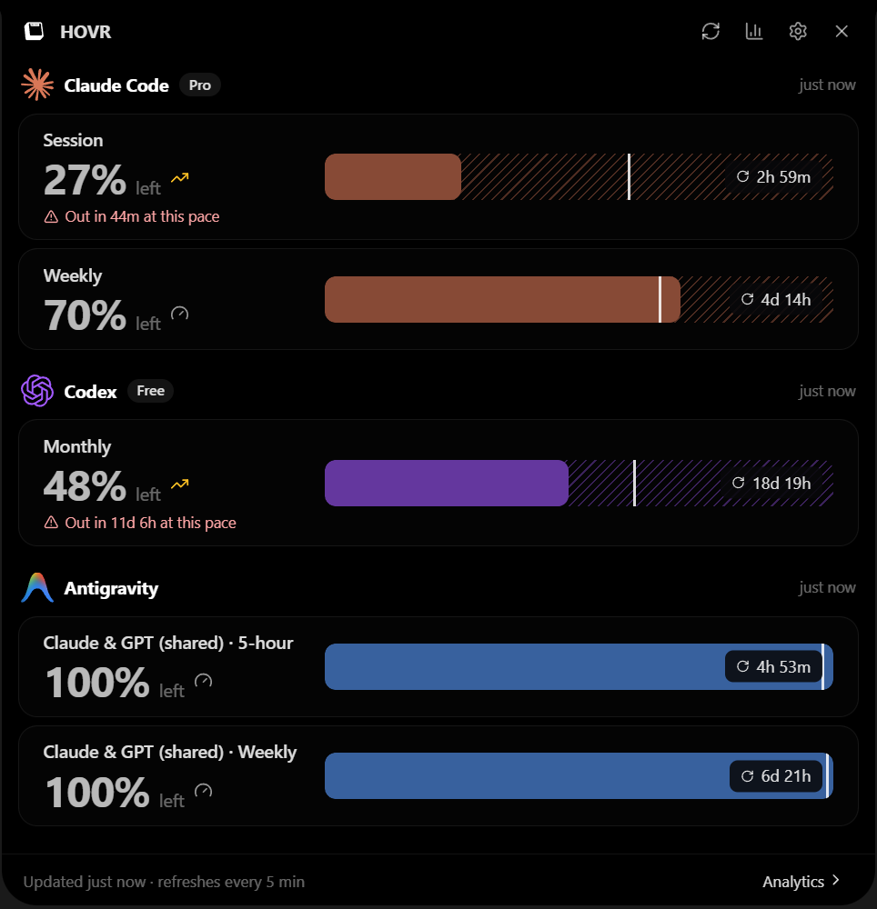
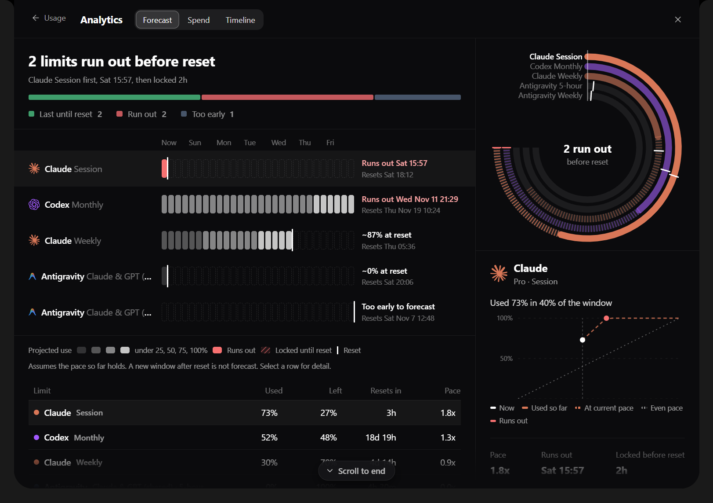
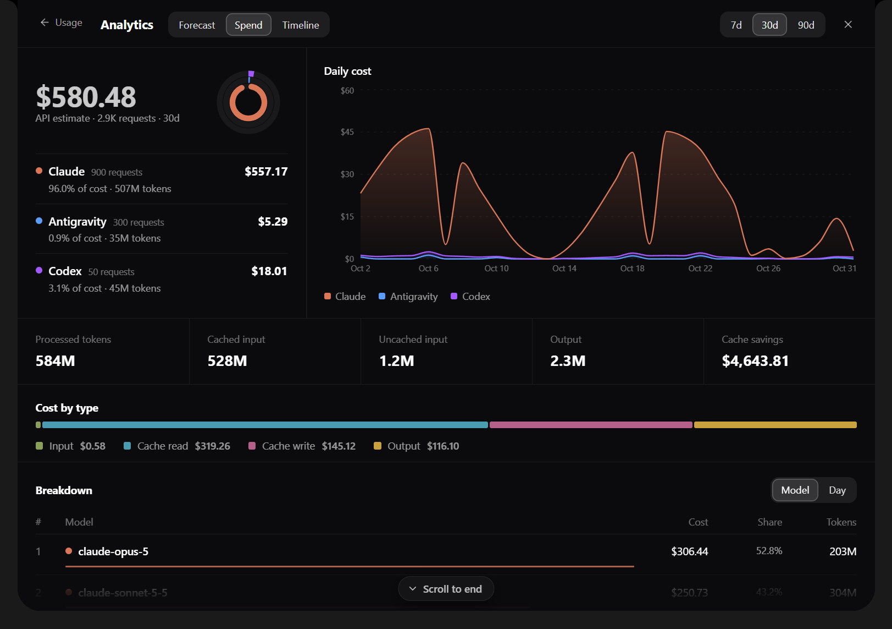
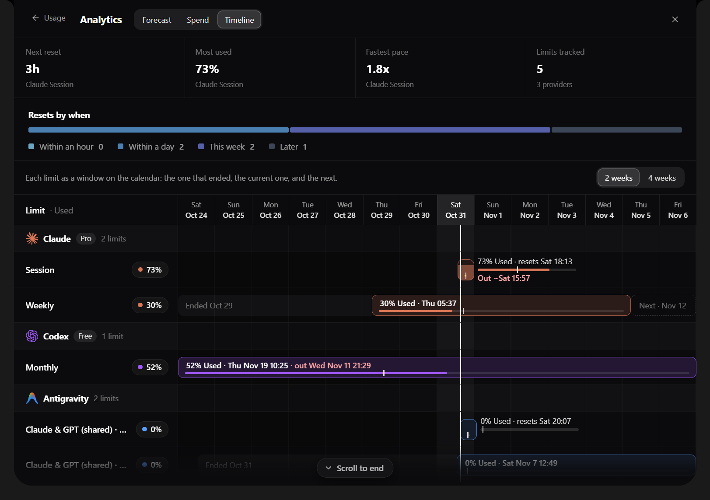
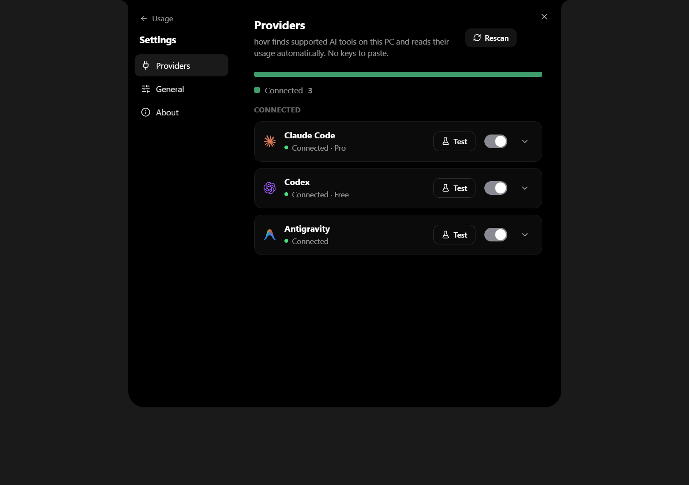

<div align="center">


<br />

**See how much of your AI coding tools' usage limits you have left, in a notch at the top of your screen.**

<a href="https://github.com/EthanRodrigues001/hovr/releases/latest">
  <picture>
    <source media="(prefers-color-scheme: dark)" srcset="https://shieldcn.dev/group/github/release/EthanRodrigues001/hovr+github/license/EthanRodrigues001/hovr+badge/platform-Windows+badge/Electron-34.svg?size=xs&variant=secondary&mode=dark" />
    
  </picture>
</a>

[Install](#install) · [Features](#features) · [Supported tools](#supported-tools) · [Privacy](#what-it-touches) · [Develop](#develop)



</div>

HOVR sits at the top-centre of your screen as a small pill. Hover it, press **Alt + C**, or click the tray icon and it opens into a card with every tool's session, weekly and monthly limits. Nothing to configure: HOVR finds the tools already installed on your PC.

## Install

HOVR is for **Windows** (x64). It is tested on Windows 11.

1. Download **`HOVR-Setup-1.0.0.exe`** from the [latest release](https://github.com/EthanRodrigues001/hovr/releases/latest).
2. Run it and press **Install**. It installs for your account only and needs no admin rights. HOVR opens as soon as it finishes.

Running the setup again on a PC that already has HOVR offers **Reinstall** or **Uninstall**. Your settings are kept when you uninstall.

HOVR checks for updates on its own and installs them when you quit.

> The installer is not code-signed yet, so Windows SmartScreen may say "Windows protected your PC". Choose **More info**, then **Run anyway**.

## Features

- **At-a-glance pill.** The collapsed notch shows what is left on the limit you will hit first, for example your Claude 5-hour session, as a small ring with the number inside.
- **Every limit in one card.** Session, weekly, monthly and per-model windows, each with a bar showing what is **left**. The white tick marks where an even spend would be right now: a fill short of the tick means you are burning faster than the window allows.
- **Forecast.** Which limits will run out before they reset, when, and for how long they stay locked.
- **Spend.** Tokens and estimated API cost per day and per model, read from your tools' local session logs.
- **Timeline.** Every limit window on one time axis, with a "resets by when" summary.
- **Alerts.** A Windows notification when a limit is nearly used up or will run out early. Each alert is shown once per window and survives restarts.
- **Quiet by design.** Hides itself over fullscreen apps, follows the display you choose, and polls gently so it does not trigger rate limits.

<div align="center">

 

 

<sub>Screenshots use sample data.</sub>

</div>

## Supported tools

| Tool | Live limits | Where HOVR reads them |
|---|---|---|
| Claude Code | Session, weekly, per-model weekly, extra-usage spend | `~/.claude/.credentials.json` → `api.anthropic.com` |
| Codex | Session / weekly / monthly (by plan) | `~/.codex/auth.json` → `chatgpt.com` |
| Cursor | Overall, Cursor-model and other-model pools | Cursor CLI or IDE login → `api2.cursor.sh` |
| Antigravity | 5-hour and weekly quotas | an existing Google login from T3 Code or the Gemini CLI → Google Cloud Code |
| Grok | Credits for the billing period | `~/.grok/auth.json` → `cli-chat-proxy.grok.com` |
| OpenCode | Go plan session / weekly / monthly | OpenCode Go key → `opencode.ai` |
| Muse, Pi, Fx, Devin, Droid, Copilot, Gemini CLI | Detected only (no usage source is known) | PATH / config folder |

Spend history is read from the local session logs of Claude Code, Codex, Antigravity and, through its dashboard, Cursor.

## Using it

- Hover the pill at the top of the screen, press **Alt + C**, or click the tray icon.
- The chart icon opens **Analytics** (Forecast, Spend, Timeline). The gear opens **Settings**: switch providers on or off, test a connection, choose what the collapsed pill shows, set the refresh interval and the display it lives on.
- Settings → General → Alerts has a **Send test** button to check that notifications reach you.

## What it touches

HOVR reads sign-in files your tools already keep and asks each tool's own service for your usage. It never modifies those files, never refreshes or rotates your tokens (if one is expired it tells you to open the tool once), never writes them anywhere, and never sends them to anyone but the service they belong to. The one other network call is an optional daily download of a public price list for the dollar estimates (switch it off in General).

The usage endpoints are the private ones each tool's own usage screen calls. They are undocumented and can change; when one does, that provider shows a message instead of numbers.

## Develop

```bash
npm install
npm run dev              # run the app
npm run typecheck
npm test
npm run build:installer  # app + the dark setup window, written to %USERPROFILE%\hovr-dist
```

Windows, Electron + React + TypeScript (electron-vite). Layout:

- `shared/`: types and pure logic shared by both processes (`usage.ts`, `usageMath.ts`, `notch.ts`, IPC contracts).
- `electron/main/providers/`: one driver per tool (`detect()` + `read()`), registered in `registry.ts`. Adding a tool is one file and one line.
- `electron/main/usageService.ts`: detect + refresh loop with per-provider throttling and backoff; publishes to the UI only on change.
- `electron/main/history/`: log scanners, pricing, aggregation.
- `electron/main/window.ts`, `geometry.ts`: the transparent top-centre window, cursor-poll hover, multi-display placement.
- `src/`: the notch, usage card, analytics and settings.
- `installer/`: the setup window. It wraps the standard Windows installer, which is also what auto-update uses.
- `scripts/make-icons.cjs`: renders the logo and every icon size from one traced shape.

Release assets: `HOVR-Setup-<version>.exe` is what people download. `HOVR-Update-<version>.exe`, its `.blockmap` and `latest.yml` are read by the in-app updater.

## Credits and licence

HOVR is licensed under the [Apache License 2.0](LICENSE).

- **Edge-Drop** by Deepender25 and contributors (Apache-2.0): https://github.com/Deepender25/Edge-Drop. HOVR started as a fork of Edge-Drop v0.2.2 (commit `5a7c907`, tagged `upstream-baseline`). It keeps the transparent edge-anchored window, the hover-expand interaction and the Electron/React structure, and replaces the clipboard-manager features with the usage-limits notch. Edge-Drop's files have been modified; `git diff upstream-baseline` shows every change.
- **T3 Code** by T3 Tools Inc. (MIT, Copyright (c) 2026 T3 Tools Inc.): https://github.com/pingdotgg/t3code. The provider usage logic follows what T3 Code does (which endpoint each tool exposes, the Antigravity conversation-database field layout and model-id table). HOVR's code for it is written fresh, and the facts above come from T3 Code's MIT-licensed source.
- **Brand marks** (Claude, OpenAI/Codex, Cursor, Antigravity, Grok, OpenCode, Gemini, Copilot, Devin, Muse, Pi) come from [@lobehub/icons](https://github.com/lobehub/lobe-icons) (MIT) and belong to their owners.
- Dollar estimates use the public [LiteLLM](https://github.com/BerriAI/litellm) (MIT) price list, downloaded at runtime and not bundled.
- Badges by [shieldcn](https://shieldcn.dev).

Claude, Codex, Cursor, Antigravity, Grok, OpenCode and the other tools named here belong to their owners; HOVR is not affiliated with or endorsed by them.
