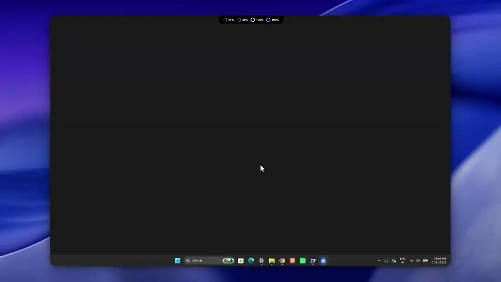

<p align="center">
  
</p>

<p align="center">
  <a href="https://github.com/EthanRodrigues001/hovr/releases/latest"></a>
  <a href="https://github.com/EthanRodrigues001/hovr/releases"></a>
  <a href="LICENSE"></a>
  <a href="https://github.com/EthanRodrigues001/hovr/commits/main"></a>
  <a href="#install"></a>
  <a href="https://www.electronjs.org"></a>
</p>

<p align="center">
  <b>HOVR</b> shows how much of your AI coding tools' usage limits you have left, in a small notch at the top of your screen.<br/>
  Hover it for every limit, when each one resets, and which will run out first. Nothing to set up.
</p>

<p align="center">
  <a href="#install">Install</a> ·
  <a href="#features">Features</a> ·
  <a href="#supported-tools">Supported tools</a> ·
  <a href="#privacy">Privacy</a> ·
  <a href="#develop">Develop</a> ·
  <a href="#credits-and-licence">Credits</a>
</p>

---

<p align="center">
  
</p>

<p align="center"><sub>A 73-second tour on a loop: usage card, Forecast, Spend, Timeline, Settings.</sub></p>

## Why HOVR

Your Claude, Codex or Cursor limits live behind a different screen in every tool, and you usually find out you are out when a request fails. HOVR keeps them in one place that is always one hover away, and tells you before you run dry.

- **It finds your tools by itself.** It reads the sign-in files they already keep, so there is no account, key or config to enter.
- **It shows pace, not just a number.** A white marker on each bar shows where an even spend would be right now, so you can see you are burning too fast while there is still time to slow down.
- **It stays out of the way.** The notch is a small pill, it hides over fullscreen apps, and it polls gently so it does not trigger rate limits.

HOVR does not track anything for you, run a server, or send your usage anywhere. It is Windows only, and it does not change your tools' settings or sign-in files.

> [!NOTE]
> **Status:** actively maintained, currently version 1.0.4. Tested on Windows 11. The usage endpoints it reads are private ones each tool's own screen uses, so a tool changing them can break that provider until HOVR is updated. HOVR shows a message in that case, not wrong numbers.

## Install

HOVR is for **Windows** (x64).

1. Download **`HOVR-Setup-1.0.4.exe`** from the [latest release](https://github.com/EthanRodrigues001/hovr/releases/latest).
2. Run it and press **Install**. It installs for your account only and needs no admin rights. HOVR opens when it finishes.

Running the setup again on a PC that already has HOVR offers **Reinstall** or **Uninstall**; your settings are kept when you uninstall. HOVR checks for updates every few hours and installs them when you quit, or from the update button in the notch header.

> [!IMPORTANT]
> The installer is not code-signed yet, so Windows SmartScreen may say "Windows protected your PC". Choose **More info**, then **Run anyway**.

**Open it** by hovering the pill at the top of the screen, pressing **Alt + C**, or clicking the tray icon.

## Features

- **At-a-glance pill.** The collapsed notch shows what is left on the limit you will hit first, as a small ring with the number inside. Settings → General → *Tools in the notch* picks which tools appear.
- **Every limit in one card.** Session, weekly, monthly and per-model windows, each as a bar of what is **left**, with the reset countdown inside it. Hover any part for the detail.
- **Forecast.** Which limits will run out before they reset, when, and how long they stay locked.
- **Spend.** Tokens and estimated API cost per day and per model, read from your tools' local session logs.
- **Timeline.** Every limit window on one time axis, with the next window shown as a dashed bar and a "resets by when" summary.
- **Alerts.** A Windows notification when a limit is nearly used up or will run out early. Each alert shows once per window and survives restarts. *Send test* in Settings checks that it reaches you.
- **Smoother animation.** An optional setting that draws with your graphics card. Helps on large screens and while screen recording.

<table>
  <tr>
    <td width="50%"><br/><sub><b>Usage.</b> What is left in each window, and the white marker for an even spend.</sub></td>
    <td width="50%"><br/><sub><b>Forecast.</b> Which limits run out early, and when.</sub></td>
  </tr>
  <tr>
    <td width="50%"><br/><sub><b>Spend.</b> Tokens and estimated cost per day and per model.</sub></td>
    <td width="50%"><br/><sub><b>Timeline.</b> Every limit window on one axis.</sub></td>
  </tr>
</table>

<p align="center"><sub>Screenshots use sample data.</sub></p>

## Supported tools

| Tool | Live limits | Where HOVR reads them |
| --- | --- | --- |
| Claude Code | Session, weekly, per-model weekly, extra-usage spend | `~/.claude/.credentials.json` → `api.anthropic.com` |
| Codex | Session, weekly or monthly (by plan) | `~/.codex/auth.json` → `chatgpt.com` |
| Cursor | Overall, Cursor-model and other-model pools | Cursor CLI or IDE login → `api2.cursor.sh` |
| Antigravity | 5-hour and weekly quotas | An existing Google login from T3 Code or the Gemini CLI → Google Cloud Code |
| Grok | Credits for the billing period | `~/.grok/auth.json` → `cli-chat-proxy.grok.com` |
| OpenCode | Go plan session, weekly and monthly | OpenCode Go key → `opencode.ai` |
| Muse, Pi, Fx, Devin, Droid, Copilot, Gemini CLI | Detected only (no usage source is known) | PATH or config folder |

Spend history comes from the local session logs of Claude Code, Codex and Antigravity, and from Cursor's dashboard.

## Privacy

HOVR reads sign-in files your tools already keep and asks each tool's own service for your usage. It never modifies those files, never writes them anywhere, and never sends them to anyone but the service they belong to.

- **Expired sign-in:** HOVR does not renew it. It tells you to open that tool once.
- **Antigravity:** the one exception. HOVR trades your stored Google refresh token for a short-lived access token, keeps it in memory only, and does not rotate or save anything.
- **Other network calls:** an update check against GitHub, and an optional daily download of a public price list for the dollar estimates (switch it off in General).
- **No analytics and no telemetry.**

## Develop

```bash
npm install
npm run dev              # run the app
npm run typecheck
npm test
npm run build:installer  # app + the dark setup window, written to %USERPROFILE%\hovr-dist
```

Electron 45, React 19, TypeScript and Vite (electron-vite). Layout:

- `shared/`: types and pure logic used by both processes (`usage.ts`, `usageMath.ts`, `forecast.ts`, `notch.ts`, IPC contracts).
- `electron/main/providers/`: one driver per tool (`detect()` + `read()`), registered in `registry.ts`. Adding a tool is one file and one line.
- `electron/main/usageService.ts`: detect and refresh loop with per-provider throttling and backoff; publishes to the UI only on change.
- `electron/main/history/`: log scanners, pricing, aggregation.
- `electron/main/window.ts`, `geometry.ts`: the transparent top-centre window, cursor-poll hover, multi-display placement.
- `src/`: the notch, usage card, analytics and settings.
- `installer/`: the setup window. It wraps the standard Windows installer, which is also what auto-update uses.
- `scripts/make-icons.cjs`: renders the logo and every icon size from one traced shape.

Release assets: `HOVR-Setup-<version>.exe` is what people download. `HOVR-Update-<version>.exe`, its `.blockmap` and `latest.yml` are read by the in-app updater.

Bugs and ideas go in [Issues](https://github.com/EthanRodrigues001/hovr/issues); the templates tell you what to include.

## Credits and licence

HOVR is licensed under the [Apache License 2.0](LICENSE).

- **Edge-Drop** by Deepender25 and contributors (Apache-2.0): <https://github.com/Deepender25/Edge-Drop>. HOVR started as a fork of Edge-Drop v0.2.2 (commit `5a7c907`, tagged `upstream-baseline`). It keeps the transparent edge-anchored window, the hover-expand interaction and the Electron/React structure, and replaces the clipboard-manager features with the usage-limits notch. Edge-Drop's files have been modified; `git diff upstream-baseline` shows every change.
- **T3 Code** by T3 Tools Inc. (MIT, Copyright (c) 2026 T3 Tools Inc.): <https://github.com/pingdotgg/t3code>. The provider usage logic follows what T3 Code does (which endpoint each tool exposes, the Antigravity conversation-database field layout and model-id table). HOVR's code for it is written fresh, and the facts above come from T3 Code's MIT-licensed source.
- **Brand marks** (Claude, OpenAI/Codex, Cursor, Antigravity, Grok, OpenCode, Gemini, Copilot, Devin, Muse, Pi) come from [@lobehub/icons](https://github.com/lobehub/lobe-icons) (MIT) and belong to their owners.
- Dollar estimates use the public [LiteLLM](https://github.com/BerriAI/litellm) (MIT) price list, downloaded at runtime and not bundled.
- Badges by [shieldcn](https://shieldcn.dev).

Claude, Codex, Cursor, Antigravity, Grok, OpenCode and the other tools named here belong to their owners; HOVR is not affiliated with or endorsed by them.
